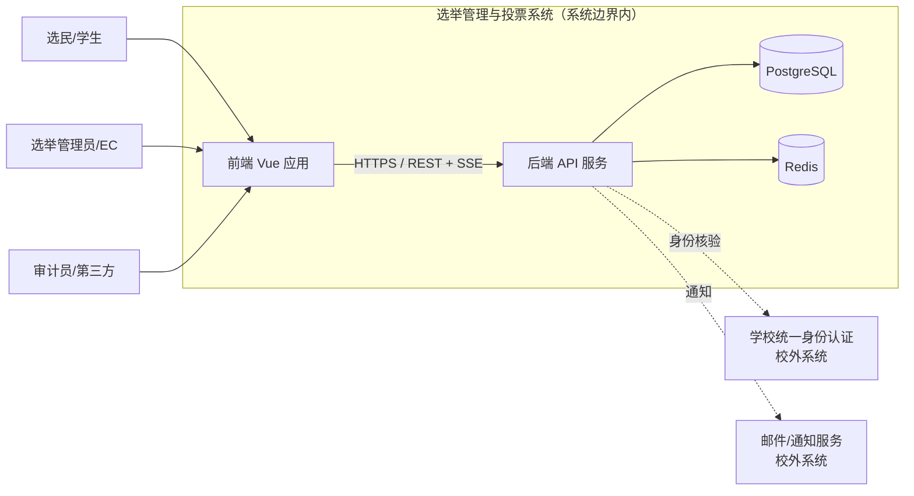
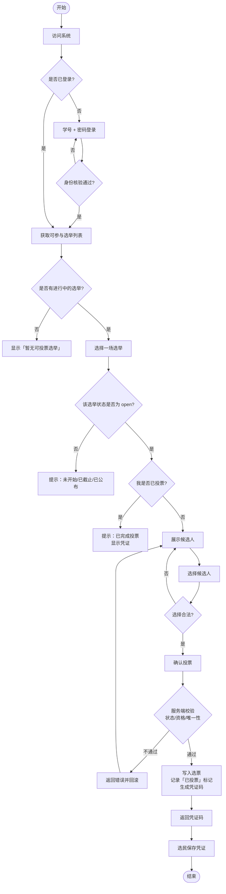
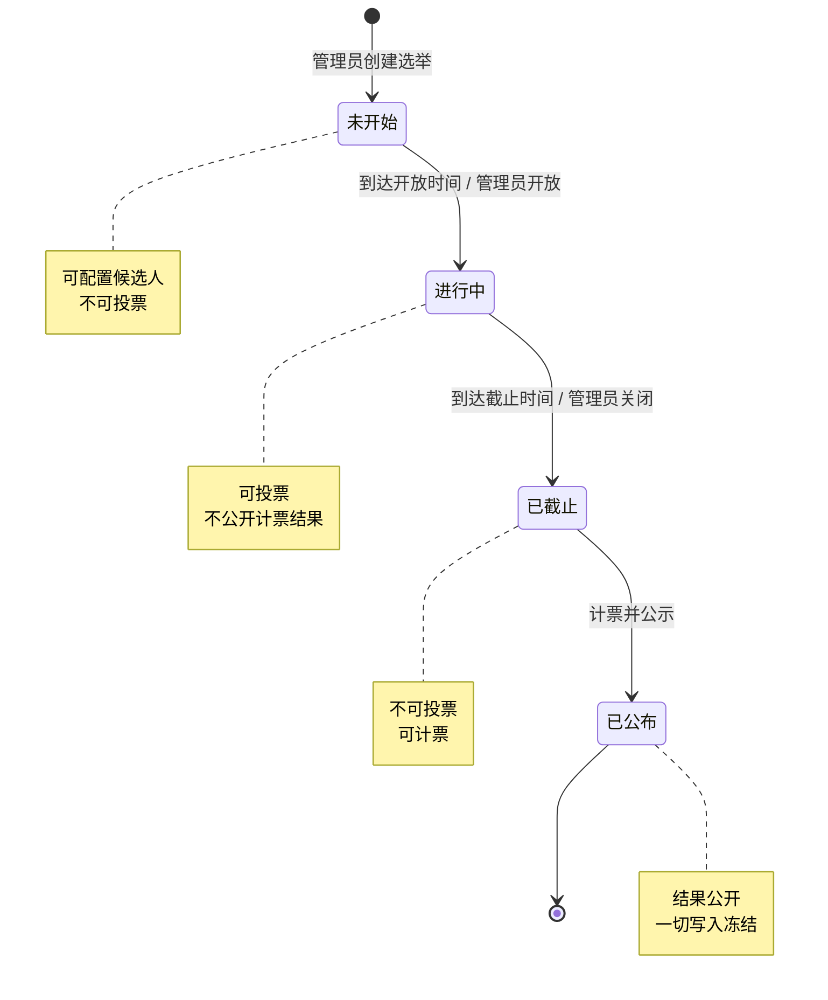
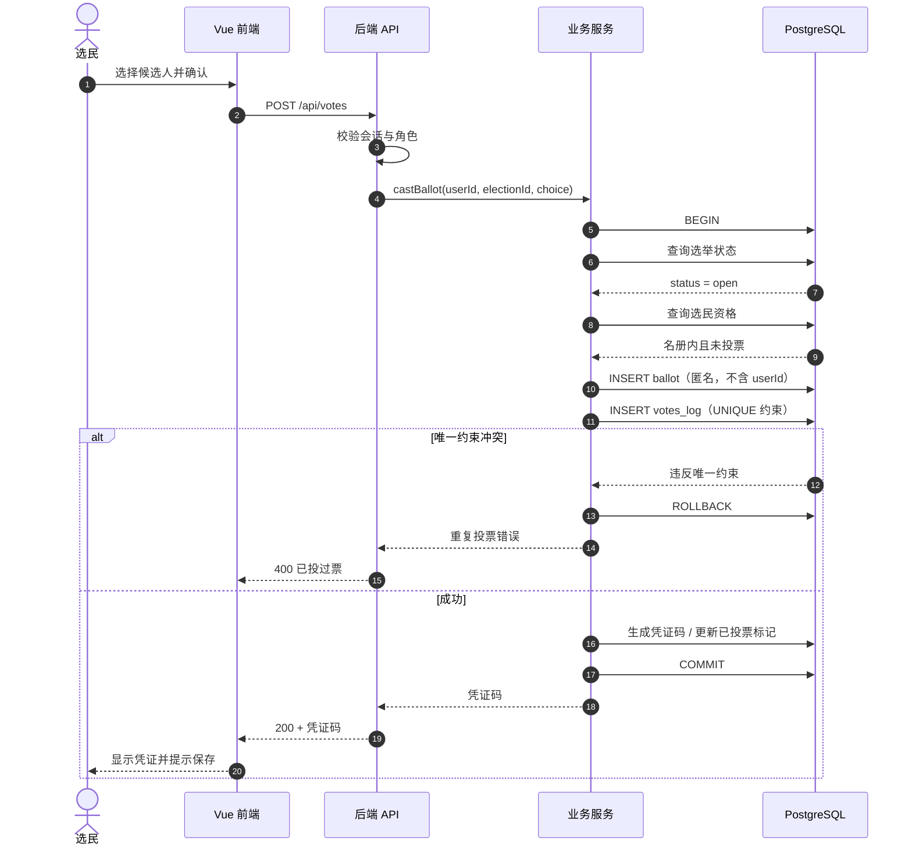
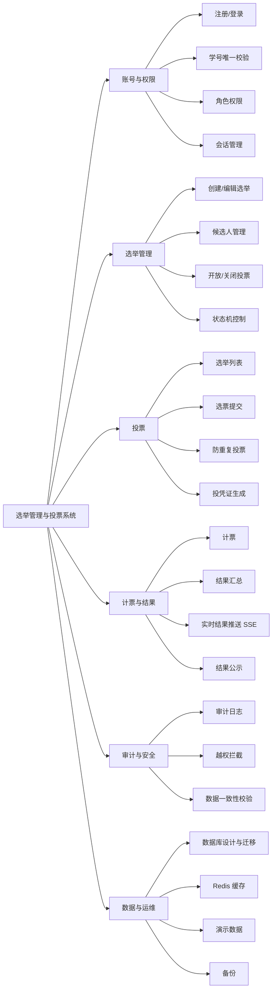
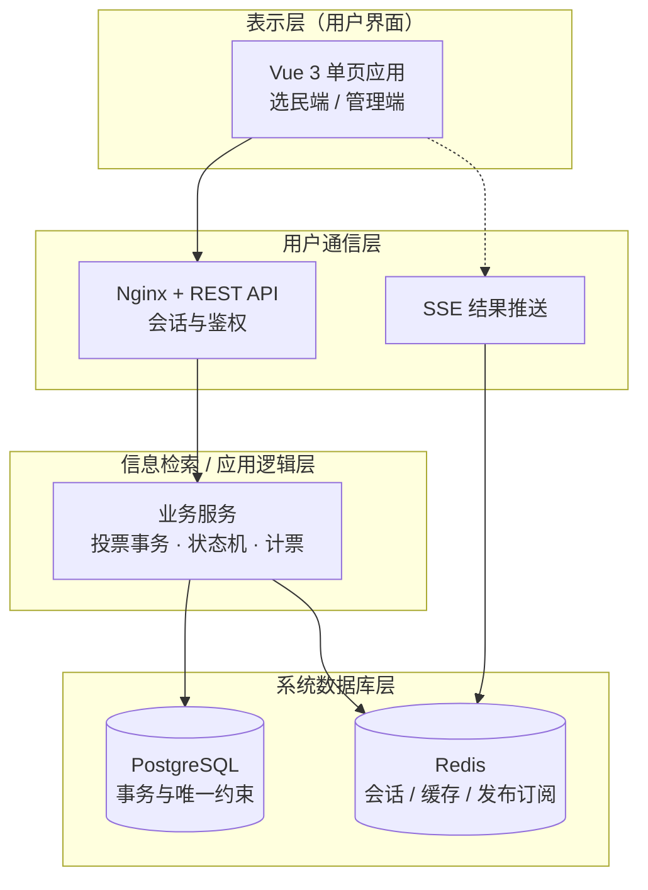

# 选举管理与投票系统 — 项目方案（流程 / 功能拆解 / 技术选型）

> COMP 3500SEF · 8500SEF 软件工程小组项目
> 选题：Election Management and Voting System
> 配套：7 人分工表（成员 1–7）

本文对应团队要求的前两步：
1. **理清处理流程 → 画出流程图 → 拆解功能 → 提取前后端功能列表**
2. **理解需求，根据需求选择开发语言及框架**

文档中的图使用 Mermaid 语法，可在 GitHub / VS Code（Markdown Preview Mermaid Support）/ Typora 直接渲染。

---

## 一、理清处理流程

### 1.1 系统上下文（Context Model）

对应 Lecture 5 的 context perspective：先划清"系统边界"，明确哪些在系统内、哪些是外部系统。



**边界决策**：身份认证不自己做，走学校 SSO / 学号库；系统只负责"选举"这件事。
写进报告的价值：Lecture 5 明确说"划边界是政治判断"，说明我们主动拒绝了"做完整身份系统"的范围膨胀。

### 1.2 核心业务处理流程（Activity Diagram）

这是**选民投票**的主流程，也是整个系统最需要严密的路径。



### 1.3 选举生命周期（State Diagram）

状态机是**必须画**的图：它把"什么时候能投、什么时候能计票"变成单一真相来源，避免出现"已截止还能投票"这类缺陷。



**关键约束（写进报告）**：状态只能沿箭头单向推进，**任何投票请求都必须先校验状态**，而不是只判断系统时间。因为"截止那一秒"存在竞态，用时间判断会漏票。

### 1.4 投票时序（Sequence Diagram）

对应 Lecture 5 的 interaction perspective，展示一次投票在系统内部如何完成。



---

## 二、功能拆解

### 2.1 模块划分（功能分解树）



### 2.2 功能 → 前后端 → 负责人 对照表

> 负责人编号对应团队分工表的成员 1–7。**每个功能都要有【前端】与【后端】两列归属**，这是拆解是否到位的检验标准。

| 模块 | 功能点 | 前端（谁） | 后端（谁） | 数据库（谁） | 测试（谁） |
|---|---|---|---|---|---|
| 账号 | 学生注册（学号+密码） | 表单、校验提示（1） | 注册接口、学号重复校验、密码哈希（3） | users 表、唯一约束（5） | 注册流程/并发重复注册（6、7） |
| 账号 | 登录/登出 | 登录页、态管理（1） | 会话/JWT（3） | 会话表或 Redis（5） | 登录失败/越权（7） |
| 权限 | 三种角色（选民/管理员/审计员） | 按角色渲染菜单（1、2） | 角色鉴权中间件（3） | role 字段（5） | 越权请求拦截（7） |
| 选举 | 创建/编辑选举 | 管理表单（2） | 创建接口、参数校验（4） | elections 表（5） | 必填/边界值（6） |
| 选举 | 候选人配置 | 候选人列表编辑（2） | 增删改接口（4） | candidates 表（5） | 排序/重复候选（6） |
| 选举 | 状态控制（开放/关闭） | 状态按钮（2） | 状态机、非法迁移拒绝（4） | status 字段 + 约束（5） | 全部迁移路径（7） |
| 投票 | 可投选举列表 | 卡片列表（1） | 按资格过滤（4） | 查询优化（5） | 无选举/已投/已截止（6） |
| 投票 | 提交选票 | 候选人单选/排序、确认弹窗（1） | 投票接口、事务（4） | 选票表 + 唯一定位（5） | 正常/并发/越权（7） |
| 投票 | 防重复投票 | 友好错误提示（1） | 唯一约束兜底 + 错误翻译（4） | UNIQUE 约束（5） | **并发抢投（7）** |
| 投票 | 凭证码 | 展示与截图提示（1） | 生成/校验接口（4） | receipts 表（5） | 凭证核验/防伪造（6） |
| 计票 | 计票 | 结果页（2） | 计票服务（4） | 结果表（5） | 计票正确性（7） |
| 计票 | 实时结果 | SSE 订阅与图表（2） | SSE 端点 + 事件推送（4） | Redis 缓存结果（5） | 断线重连（7） |
| 审计 | 审计日志 | 日志列表（2） | 写入与查询接口（3） | audit_log 表（5） | 篡改检测（7） |
| 运维 | 演示数据 | — | 生成脚本（4） | 种子数据（5） | 数据可重复生成（6） |

### 2.3 前端功能列表（可直接当任务清单）

**成员 1：用户与选民页面**
- 注册页：学号、姓名、密码、确认密码；前端即时校验（学号格式、两次密码一致）
- 登录页：学号 + 密码；错误提示区分"账号不存在 / 密码错误"
- 选举列表页：卡片展示进行中/已截止/已公布；显示"我是否已投票"
- 候选人展示区：单选（多数决）与排序（排序复选）两种交互
- 投票确认：二次确认弹窗，防误触
- 投票结果页：凭证码展示、复制按钮、截图提示
- 全局：加载态、空态、错误态；移动端适配

**成员 2：管理员页面**
- 管理看板：选举列表 + 状态 + 投票率
- 创建/编辑选举表单：标题、说明、开放与截止时间、计票方式
- 候选人管理：增删改、排序
- 状态控制：开放 / 关闭 / 计票公示（非法操作置灰）
- 结果展示：柱状图 / 逐轮淘汰表
- 实时结果：SSE 订阅，断线自动重连提示
- 统一视觉样式与手机适配

### 2.4 后端功能列表（可直接当任务清单）

**成员 3：账号与权限**
- `POST /api/auth/register`：学号重复校验（用户名唯一约束兜底）、密码 bcrypt/argon2 哈希
- `POST /api/auth/login`：签发会话或 JWT
- `POST /api/auth/logout`
- `GET /api/auth/me`
- 角色鉴权中间件：`@RequireRole(ADMIN)` 等
- 会话存储：Redis（或数据库表），支持过期与主动失效

**成员 4：选举与投票**
- `GET /api/elections`、`GET /api/elections/{id}`
- `POST /api/elections`、`PUT /api/elections/{id}`（仅管理员）
- `POST /api/elections/{id}/candidates`（候选人配置）
- `PATCH /api/elections/{id}/status`：**只允许状态机定义的迁移**
- `POST /api/votes`：**单事务**完成"校验状态 → 校验资格 → 写选票 → 记录已投 → 生成凭证"
- `GET /api/receipts/{code}`：凭证核验（**只返回"已计入/未计入"，不返回选择内容**）
- `GET /api/results/{electionId}`：截止后才可返回
- `GET /api/events/results`：SSE 实时推送
- 统一异常处理：业务错误 → 4xx，未知错误 → 5xx，不泄漏堆栈

**成员 5：数据库**
- ER 图与表结构：users / elections / candidates / voter_roll / ballots / votes_log / receipts / results / audit_log
- 主外键与**唯一约束**：
  - `users.student_id` UNIQUE
  - `votes_log(election_id, position_id, user_id)` UNIQUE ← **防重复投票的最后一道防线**
  - `receipts.code` UNIQUE
- 事务设计：投票事务隔离级别、失败回滚
- 迁移脚本（Flyway / Alembic）
- 演示数据生成
- 备份与恢复演练

**成员 6 / 7：测试**
- 6（功能与界面）：用户流程测试、错误提示文案、手机页面、空态
- 7（接口与集成）：自动化接口测试、越权请求、**并发重复注册/投票**、事务回滚、全流程回归

---

## 三、技术选型与理由

### 3.1 按需求选技术

| 需求 | 选型 | 选择理由 |
|---|---|---|
| 界面交互多、要组件化 | **Vue 3** | 组件化与响应式适合"列表 + 表单 + 图表"；生态成熟；团队上手快于 Angular |
| 前后端分离、实时结果 | REST + **SSE** | SSE 单向推送正好匹配"服务器推结果给页面"，比 WebSocket 简单、无需双向通道、自动重连；HTTP/1.1 即可 |
| 强一致、事务、唯一约束 | **PostgreSQL** | 唯一约束与事务语义直接支撑"防重复投票"，是**用数据库保证正确性**而非靠应用层自觉 |
| 高并发读、会话/结果缓存 | **Redis** | 会话存储 + 热门结果缓存；也是 SSE 多实例下的消息通道（Pub/Sub） |
| 后端语言 | **Java + Spring Boot** 或 **Python + FastAPI** | 见下表权衡 |

### 3.2 后端框架权衡（关键决策，建议写进 ADR）

| 维度 | Java + Spring Boot | Python + FastAPI |
|---|---|---|
| 事务与并发控制 | **强**：`@Transactional` + JPA 成熟，隔离级别控制细 | 较好：需自行管理 Session/事务边界 |
| SQL 唯一约束集成 | 成熟，异常映射清晰 | 成熟（SQLAlchemy IntegrityError） |
| 类型与接口契约 | **强**：编译期检查，适合多人协作 | 中：Pydantic 运行时校验 |
| 开发速度（小团队） | 中：配置略重 | **快**：几行起服务 |
| SSE 支持 | 支持（SseEmitter） | **支持（StreamingResponse）** |
| 团队学习成本 | 较高（若无人会 Java） | **低** |
| 部署 | 需 JVM | 轻量 |

**建议**：
- 若组里**有人写过 Java** → 选 **Spring Boot**，报告里可强调"企业级事务与分层架构"；
- 若组里**以 Python 为主、只有 8 周左右开发窗口** → 选 **FastAPI**，把时间留给需求工程与测试（这两项才占分）。

> 不选 Django 的理由（团队已给出且成立）：封装重、学习曲线长、扩展不灵活；对"以 API 为中心 + 前后端分离"的项目，FastAPI 更直接。

### 3.3 架构建议：用课程给的应用架构，而不是自己发明

`Lecture 6` 把应用系统分成四类（数据处理 / **事务处理** / 事件处理 / 语言处理）。
**我们的系统属于「事务处理系统（Transaction Processing System）」**：
用户发出请求 → 更新数据库中的信息 → 返回结果。`Lecture 6` 第 47–51 页给出了这类系统的**标准分层架构**，同时也以 Mentcare（医疗信息系统）为例做过示范。

所以架构不需要原创，**直接采用课程给的三层 + 信息检索层**，并在报告里说明"我们识别出本项目属于事务处理类应用，因此复用该应用架构模板"——这是 `Lecture 6` 明确认可的用法（"Use of application architectures: as a starting point / design checklist"）。



**为什么不是微服务**：7 人、约 8 周、课程作业。`Lecture 6` 强调"架构要服务于非功能需求"；对本项目，关键非功能需求是**数据一致性（防重复投票）**与**开发效率**，微服务在这两点上都是负收益。分层单体 + 明确接口足够，拆分可能性写进"演化"章节即可。

### 3.4 用 `4+1` 视图组织架构章节

`Lecture 6` 第 19 页给了 4+1 视图模型。报告里按这个组织会显得很专业，而且**每一视图我们都有现成材料**：

| 视图 | 本项目的呈现方式 | 谁能做 |
|---|---|---|
| **逻辑视图** | 领域类图（Election / Candidate / Ballot / VoterRoll / Receipt） | 建模负责人 |
| **过程视图** | 投票事务时序图、SSE 推送过程 | 建模负责人 |
| **开发视图** | 分层包结构图（前端 / 网关 / 服务 / 数据） | 架构负责人 |
| **物理视图** | 部署图（浏览器 → Nginx → 应用 → PG/Redis） | 架构负责人 |
| **+1 场景** | 用"投票"这个用例串起上面四个视图 | 需求负责人 |

### 3.5 用课程给的**架构模式**来论证我们的分层

`Lecture 6` 第 23–27 页把 MVC 与 Layered 都写成了"何时用 / 优点 / 缺点"的表格。报告里应当**引用并对照**，而不是只说"我们用了分层"：

- **MVC**：前端 Vue 天然是 MVVM 变体；后端"控制层 → 业务层 → 数据层"对应 Controller → Service → Repository。引用 `Lecture 6` 的"when used"条件说明我们**为什么**需要它（数据有多种呈现方式：列表、图表、实时流）。
- **Layered**：`Lecture 6` 明确指出分层的一个优点是"**multi-level security**"，且"层接口变化时只影响相邻层"——这正好支撑我们"把敏感数据放在内层、把匿名化做在服务层"的设计。

> 一句话可以直接进报告：**"我们参照 Lecture 6 的 Layered architecture 模式，将关键资产（选票明文）限制在最内层，并按该模式给出的 multi-level security 场景论证分层收益。"**

---

## 四、几条会直接影响分数的建议

### 4.1 ⚠️ 用 SSE 实时推送结果的两个前提

1. **进行中不得公开各候选人票数**。真实选举在投票期间只公布**投票率**，公布票数会引导投票、损害公平性。建议：进行中只推"已投票人数/投票率"，**票数在截止并计票后才推**。
2. **匿名性不能被实时流破坏**。推送内容必须是**聚合值**，绝不能推送"某张选票"或带 user_id 的信息。

这两条写进 SRS 的非功能需求，答辩时是加分点。

### 4.2 匿名与审计：本项目的核心设计决策（务必有人认领）

选举系统最有价值的设计不是 CRUD，而是这条矛盾：**既要查不出谁投了谁，又要能审计有没有作弊**。建议在表结构层面做**物理隔离**：

```
voter_roll(选民册)  →  记录"谁投了"（has_voted），不含 ballot_id
ballots(选票)       →  记录"投了什么"，不含 user_id
receipts(凭证)      →  唯一桥梁，凭证码只发给选民本人
```

再配一个**追加型审计日志**（每条记录的哈希包含上一条的哈希），可检测"有人直接改数据库"。

> 分工表里目前**没有人明确负责这块**。建议交给成员 5（数据库）主导设计、成员 4 实现，并写一份 ADR 记录理由。

### 4.3 分工表的三处缺口（建议补进表格）

| 缺口 | 风险 | 建议 |
|---|---|---|
| **需求文档 / 系统建模无人认领** | 评分表第一项就是 requirement engineering，System Modeling 也是独立主题 | 从成员 6 或 2 分出部分职责，或明确"由成员 X 兼" |
| **报告、演示视频、logbook 无人认领** | Report 15% + Presentation 10% + Logbook 15% | 明确一人统筹（建议组长） |
| **接口契约无冻结机制** | 7 人并行开发必然对不上 | 先出 `API_CONTRACT.md` + 建库脚本冻结，再分头写 |

### 4.4 AI 生成代码的团队规范（团队建议里提到 Agent+Skills，需要补规则）

用 AI 提效没问题，但 7 个人各用各的会**风格不一致、架构漂移**。建议定三条：

1. **统一生成入口**：共用同一份"项目约定"文档（目录结构、命名、错误码、分层规则），喂给 AI 时保持一致；
2. **生成后必须人工 review + 通过测试**才可合入。测试由成员 6/7 把控，这是质量闸门；
3. **如实披露**：课程明确要求说明 AI 使用情况，且 logbook 是**个人独立评分**、"answering questions about their participation"。所以每个人必须能讲清**自己那块代码**，不能只当搬运工。

### 4.5 把课程给的**文档模板**直接用上（最容易拿分、最常被忽略）

课程材料里已经给了两套现成模板，照抄结构即可，不必自己发明格式：

**① 需求文档结构**（`Lecture 4` 第 68–69 页）

| 章节 | 我们写什么 |
|---|---|
| Preface / Introduction | 系统目的：管理并执行校内选举，替代人工投票 |
| Glossary | 选举、候选人、选票、凭证码、状态机、IRV 等术语表 |
| User requirements definition | 三类用户的诉求：选民 / 选举管理员 / 审计员 |
| System architecture | 引用第三章的分层架构图 |
| System requirements specification | **编号的功能需求 + 非功能需求** |
| System models | 引用第四张 UML 图 |
| **System evolution** | 预计的变化：增加排序复选、多轮投票、校外认证对接 |
| Appendices | 数据库逻辑设计、接口清单 |

> `Lecture 4` 第 54 页给了写作规范：**用 `shall` 表示强制需求、`should` 表示期望**，并**为每条需求附上理由（rationale）**。这一条写进去，文档质量立刻区别于其他组。

**② 用例的表格化描述**（`Lecture 5` 第 18 页）

不要只画个用例图就结束。`Lecture 5` 明确要求"图形概览 + 详细表格"。示例：

| 字段 | 内容（"投票"用例） |
|---|---|
| Actors | 选民；身份认证系统 |
| Description | 选民选定候选人后提交选票，系统校验资格与唯一性并记录结果 |
| Data | 选举 ID、职位 ID、候选人选择、学号 |
| Stimulus | 选民点击"确认投票" |
| Response | 返回凭证码，表示选票已计入 |
| Comments | 需要先登录且该选举处于进行中状态 |

**③ 场景（Scenario）**（`Lecture 4` 第 46–48 页）

覆盖"正常流程 / 出问题的情况 / 其他并发活动 / 结束状态"。投票用例的"出问题时"可以写：重复投票、选举已截止、会话过期、网络中断后重试——这四条**正好对应你们要写的测试用例**（成员 6/7 直接拿来用）。

---

## 五、课程材料 → 项目产出的对照表（谁用哪份材料）

> 用途：开会时每个人知道该看哪份材料、产出什么东西。**这也是报告"过程"章节的现成素材。**

| 课程材料 | 关键内容 | 对应项目产出 | 负责人 |
|---|---|---|---|
| Lecture 1 | 软件属性、基本活动、**ACM/IEEE 八条伦理** | 伦理章节 / AI 使用声明 | 全体 |
| Lecture 2 | 过程模型、**测试阶段**（组件/系统/客户）、演化 | 开发过程选择、测试策略 | 组长、测试 |
| Lecture 3 | **Scrum 角色/工件/仪式**、团队 5–9 人 | 项目管理方式、任务板 | 组长 |
| Lecture 4 | 功能/非功能需求、**文档结构**、需求冲突、变更管理 | SRS 需求文档 | 需求负责人 |
| Lecture 5 | 用例图/**用例表格**、时序图、类图、状态图、场景 | 系统建模章节 | 建模负责人 |
| Lecture 6 | **事务处理系统架构**、MVC/分层模式、4+1 视图 | 架构章节 | 架构负责人 |
| Mentcare 需求文档 | **真实需求文档的样例格式**（编号 + 章节） | SRS 参照模板 | 需求负责人 |
| Insulin pump 案例 | 安全攸关系统的**两条高层需求**写法 | 非功能需求写法参考 | 需求负责人 |
| tutorial 5 solution | 需求验证四问题、**需求变更管理流程** | 需求验证与变更记录 | 需求负责人 |
| tutorial 6 | 类图关系辨析、**时序图设计要点** | 建模图评审 | 建模负责人 |

---

## 六、下一步（建议按此顺序推进）

1. **冻结 API 契约与数据库 schema**（成员 4、5 主导，1–2 天）→ 解除其他人的阻塞；
2. **画完 4 张图**（上下文 / 活动 / 状态 / 时序）+ **2 张用例表格** → 放进报告的系统建模章节；
3. **补需求文档**：按 `Lecture 4` 的章节结构写，功能需求 + 非功能需求**编号表**，每条附理由；非功能需求要可度量（例："100 并发下 p95 < 300ms"）；
4. **定技术栈并写 ADR**（1 页），明确"为什么是事务处理系统架构""为什么不用微服务""为什么用 PostgreSQL 唯一约束防重复投票"；
5. **搭骨架并跑通一条最小链路**（登录 → 列表 → 投票 → 凭证），再按模块并行开发。

