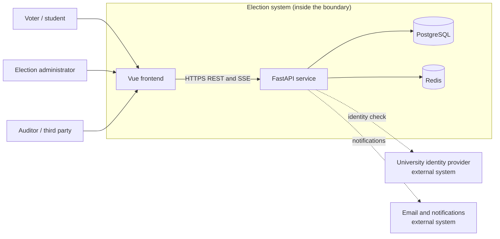
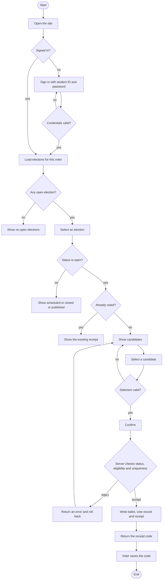
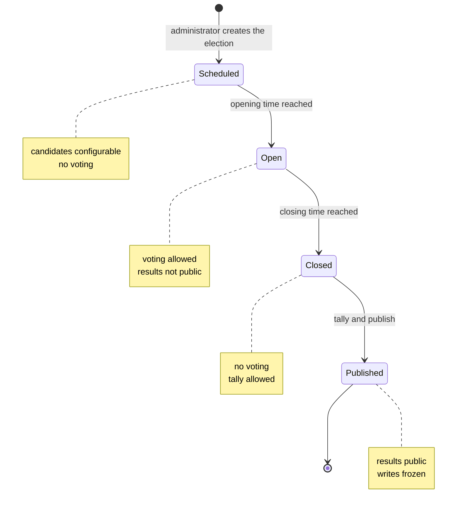
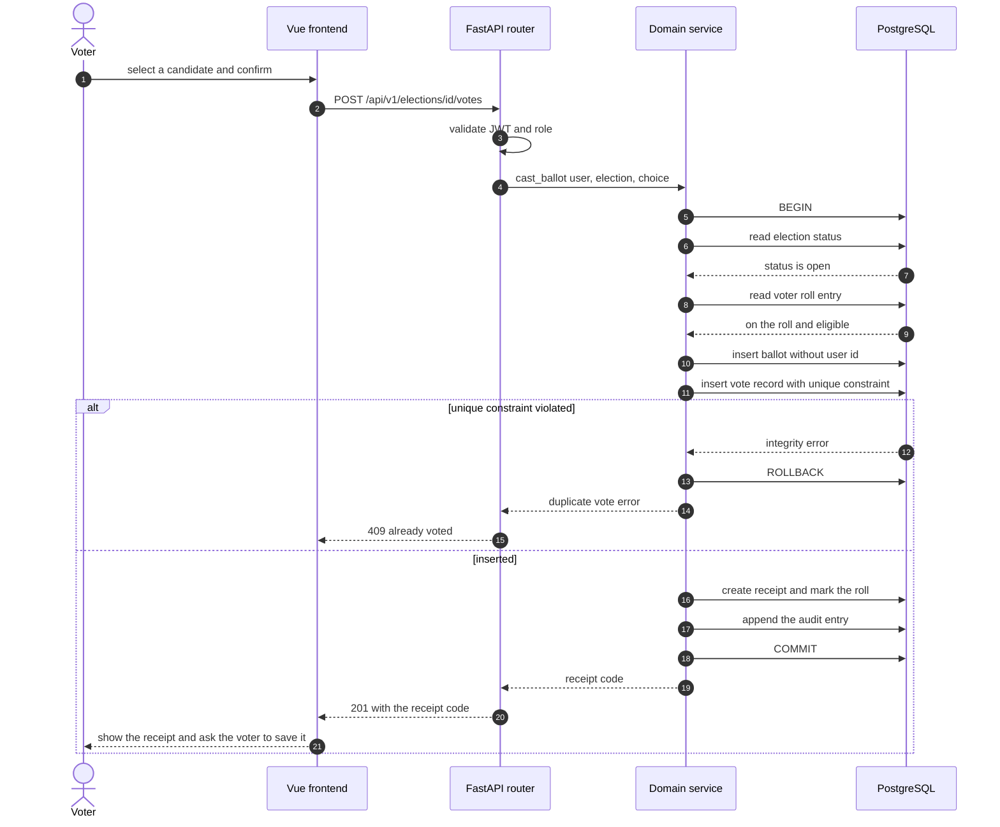
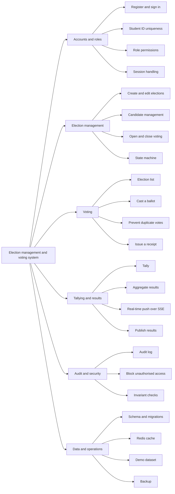
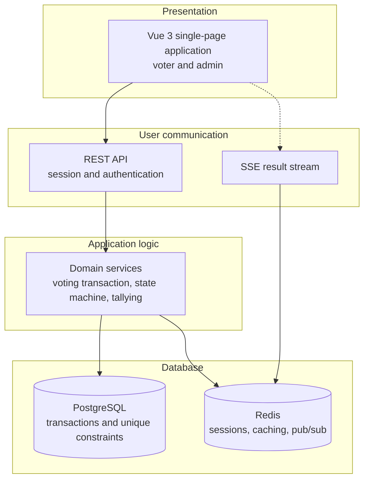

# Project Plan — Process, Features and Technology Choice

> COMP 3500SEF / 8500SEF — Software Engineering, group project
> Topic: Election Management and Voting System
> Team: 7 members

This document covers the first two steps of our plan:

1. **Clarify the process, draw the flows, decompose the features, extract the frontend and backend feature lists**
2. **Understand the requirements, then choose language and framework based on them**

All diagrams are Mermaid and render directly on GitHub or in VS Code.

---

## 1. Process

### 1.1 System context

Following the context perspective from Lecture 5, we first fix the system boundary.



**Boundary decision**: identity provision is not built in-house; it is delegated to the university
identity provider. The system is responsible only for elections. Lecture 5 notes that defining a
boundary is a political judgement; here it is how we refuse scope creep.

### 1.2 Core voting flow (activity diagram)



### 1.3 Election lifecycle (state diagram)



**Key constraint**: a request is accepted based on **state**, not on a comparison with the current
time. Time only advances the state; the state is the single source of truth. Comparing timestamps
creates a race at the closing instant.

### 1.4 Voting sequence



---

## 2. Feature decomposition

### 2.1 Module tree



### 2.2 Feature ownership

Member numbers refer to the team table. Every feature has both a frontend and a backend owner;
that is the test of whether the decomposition is complete.

| Module | Feature | Frontend | Backend | Data | Test |
|---|---|---|---|---|---|
| Accounts | Register | form and validation (1) | endpoint, uniqueness, hashing (3) | users table (5) | concurrent duplicate registration (6, 7) |
| Accounts | Sign in and out | login page, state (1) | JWT (3) | sessions or Redis (5) | wrong password (7) |
| Roles | Voter, admin, auditor | render by role (1, 2) | role dependency (3) | role column (5) | unauthorised request (7) |
| Elections | Create and edit | admin form (2) | endpoint and validation (4) | elections table (5) | required fields (6) |
| Elections | Candidates | candidate editor (2) | create and update (4) | candidates table (5) | ordering and duplicates (6) |
| Elections | Status control | status buttons (2) | state machine (4) | status column (5) | every transition path (7) |
| Voting | Eligible election list | cards (1) | filter by roll (4) | query tuning (5) | no election, voted, closed (6) |
| Voting | Cast a ballot | candidate selection (1) | vote endpoint and transaction (4) | ballots and votes_log (5) | normal, concurrent, unauthorised (7) |
| Voting | Duplicate prevention | friendly errors (1) | unique constraint and error mapping (4) | UNIQUE constraint (5) | concurrent duplicate votes (7) |
| Voting | Receipt | display and copy (1) | issue and verify (4) | receipts table (5) | forged code (6) |
| Results | Tally | results view (2) | tally service (4) | results table (5) | tally correctness (7) |
| Results | Real-time turnout | SSE and chart (2) | SSE endpoint (4) | Redis pub/sub (5) | reconnect (7) |
| Audit | Audit log | log viewer (2) | append and query (3) | audit_log table (5) | tamper detection (7) |
| Operations | Demo data | none | seed script (4) | seed data (5) | repeatable seed (6) |

### 2.3 Frontend feature list

**Member 1, voter-facing pages**

- Login page: student ID and password, distinct messages for an unknown account and a wrong password
- Election list: card layout, status badge, turnout progress, already-voted state
- Ballot: single choice and ranked choice interactions
- Confirmation: a second step so a vote is not cast by accident
- Receipt: large code, copy button, warning that it cannot prove the choice
- Loading, empty and error states; mobile layout

**Member 2, admin pages**

- Dashboard: election list with status and turnout
- Create and edit an election: title, description, opening and closing time, tally method
- Candidate management: add, remove, reorder
- Status control: open, close, tally and publish, with illegal actions disabled
- Results: bar chart plus a round-by-round table for ranked choice
- Real-time: SSE subscription with a reconnect indicator
- Consistent styling and responsive layout

### 2.4 Backend feature list

**Member 3, accounts and permissions**

- `POST /api/v1/auth/register` with a unique student ID and bcrypt hashing
- `POST /api/v1/auth/login` issuing a JWT
- `GET /api/v1/auth/me`
- Role dependency for admin and auditor endpoints
- Session invalidation through token expiry

**Member 4, elections and voting**

- `GET /api/v1/elections`, `GET /api/v1/elections/{id}`
- `POST /api/v1/elections`, admin only
- `PATCH /api/v1/elections/{id}/status`, only transitions defined by the state machine
- `POST /api/v1/elections/{id}/votes`, one transaction: check status, check the roll, write the
  ballot, claim the vote, create the receipt
- `GET /api/v1/receipts/{code}`, returns counted or not, never the choice
- `GET /api/v1/elections/{id}/results`, only after closing
- `GET /api/v1/events/turnout`, SSE turnout
- Uniform error handling: business errors map to 4xx, unknown errors to 5xx, no stack traces

**Member 5, data**

- Schema: users, elections, positions, candidates, voter_roll, ballots, votes_log, receipts,
  results, audit_log
- Keys and constraints:
  - `users.student_id` UNIQUE
  - `votes_log(position_id, user_id)` UNIQUE, the final guarantee of one vote per voter
  - `receipts.code` UNIQUE
- Transaction design and rollback behaviour
- Migrations with Alembic
- Demo dataset, backup and restore

**Members 6 and 7, testing**

- 6: user-flow tests, error message wording, mobile layout, empty states
- 7: API tests, authorisation tests, concurrent duplicate registration and voting, transaction
  rollback, full regression

---

## 3. Technology choice

### 3.1 Selection driven by the requirements

| Requirement | Choice | Reason |
|---|---|---|
| Component-based UI | **Vue 3** | lists, forms and charts; fast to learn |
| Server-to-browser updates | REST + **SSE** | one-way push fits the use case, simpler than WebSocket, automatic reconnect |
| Strong consistency and transactions | **PostgreSQL** | unique constraints and transactions underpin one vote per voter |
| High read volume and sessions | **Redis** | session storage, result caching and the pub/sub channel for SSE |

### 3.2 Backend: **Python + FastAPI**

| Dimension | Spring Boot | **FastAPI, chosen** |
|---|---|---|
| Transaction control | strong | adequate, explicit session boundaries |
| SQL constraint integration | mature | mature, integrity error mapped to 409 |
| Type and contract checking | compile time | Pydantic v2 at runtime, OpenAPI generated |
| Development speed | medium | fast |
| SSE support | SseEmitter | StreamingResponse, no extra dependency |
| Learning cost for the team | high | low |

**Reasons**

1. The team already knows Python and the schedule is short.
2. Pydantic models double as the interface contract and OpenAPI is generated automatically.
3. SSE takes a few lines with StreamingResponse.
4. Async I/O suits many short vote requests plus long-lived SSE connections.
5. Most importantly, the final guarantee of one vote per voter comes from a database constraint,
   not from the framework, so giving up Spring's transaction features costs little.

**Full stack**

| Layer | Technology | Version | Purpose |
|---|---|---|---|
| Frontend | Vue 3 + TypeScript | 3.4+ / 5.x | single-page application |
| Build | Vite | 5.x | dev server and bundling |
| State | Pinia | 2.x | session and election data |
| Routing | Vue Router | 4.x | navigation |
| Charts | ECharts | 5.x | result visualisation |
| HTTP client | Axios | 1.x | REST calls |
| Real-time | EventSource | native | SSE subscription |
| Backend | Python + FastAPI | 3.11+ / 0.115+ | REST API |
| Validation | Pydantic | v2 | request and response models |
| ORM | SQLAlchemy | 2.0 async | transactions and data access |
| Driver | asyncpg | 0.29+ | PostgreSQL async driver |
| Migrations | Alembic | 1.x | schema versioning |
| Server | Uvicorn | 0.27+ | ASGI server |
| Auth | python-jose + bcrypt | any | JWT and password hashing |
| Database | PostgreSQL | 16 | primary data and constraints |
| Cache | Redis | 7 | sessions, caching and pub/sub |
| Testing | pytest, pytest-asyncio, httpx | any | unit and API tests |
| Containers | Docker Compose | any | local PostgreSQL and Redis |

> Django was rejected as too heavily abstracted and slow to learn; Flask lacks async and built-in
> validation, so Pydantic and OpenAPI would have to be wired by hand.

### 3.3 Architecture: reuse the course template

Lecture 6 classifies applications into four types: data processing, transaction processing, event
processing and language processing. Ours is a **transaction processing system**: a request updates
information in a database and returns a result. Lecture 6 gives the standard layered architecture
for this type and demonstrates it with the Mentcare system.

We therefore reuse that template rather than inventing one, and state this in the report.



**Why not microservices**: seven people, about eight weeks, a course project. Lecture 6 stresses
that architecture serves non-functional requirements; here the critical ones are data consistency
and delivery speed, and microservices harm both. A modular monolith with clear interfaces is
sufficient, and the split option is recorded in the evolution section.

### 3.4 Organising the architecture chapter with the 4+1 view model

| View | How we present it | Owner |
|---|---|---|
| Logical | domain class diagram: election, position, candidate, ballot, voter roll, receipt | modelling |
| Process | voting transaction sequence and SSE delivery | modelling |
| Development | package layout: frontend, gateway, service, data | architecture |
| Physical | deployment diagram: browser, Nginx, application, PostgreSQL, Redis | architecture |
| Scenarios, plus one | the cast-a-vote use case ties the views together | requirements |

### 3.5 Using the course architectural patterns

- **MVC**: the Vue frontend is a view-model; the backend maps controller to service to repository.
  The when-used criteria in Lecture 6 justify it because the data has several presentations:
  list, chart and live stream.
- **Layered**: Lecture 6 notes that layering supports multi-level security and that a change in one
  layer interface only affects its neighbours. This supports keeping sensitive assets in the
  innermost layer and anonymising in the service layer.

---

## 4. Guidance that affects the grade

### 4.1 Two conditions for real-time results

1. **No per-candidate counts while voting is open.** Real elections publish turnout only, because
   publishing counts influences later voters. Push turnout during voting and counts after closing.
2. **The stream must not weaken anonymity.** Only aggregates are published, never a ballot or any
   value carrying a user identifier.

### 4.2 Anonymity and audit: the core design decision

The most valuable design is not CRUD. Separate the data physically:

```
voter_roll   who voted      has_voted      no ballot_id
ballots      what was cast  choice_enc     no user_id
receipts     the only bridge, given to the voter
```

Add an append-only audit log whose entries hash the previous entry, so direct database edits can be
detected.

### 4.3 Gaps in the original allocation

| Gap | Risk | Action |
|---|---|---|
| No owner for requirements and modelling | the first rubric item is requirements engineering | assign explicitly |
| No owner for report, video and logbook | report 15 percent plus presentation 10 percent plus logbook 15 percent | one coordinator |
| No interface freeze | three backend owners will drift | publish the API contract first |

### 4.4 Team rules for AI-assisted code

1. Share one project convention document so generated code follows the same structure and naming.
2. Every generated change is reviewed and must pass the tests before merging.
3. Disclose AI assistance honestly in the logbook and be able to explain your own module.

### 4.5 Reusing the course document templates

**Requirements document structure** from Lecture 4:

| Section | What we write |
|---|---|
| Preface and introduction | purpose of the system |
| Glossary | election, position, candidate, ballot, voter roll, receipt, state machine, IRV |
| User requirements | needs of voter, administrator and auditor |
| System architecture | the layered diagram from section 3.3 |
| System requirements | numbered functional and non-functional requirements |
| System models | the UML models from section 1 |
| System evolution | planned changes: ranked choice, multiple rounds, identity provider |
| Appendices | database design and interface list |

Lecture 4 also requires `shall` for mandatory and `should` for desirable requirements, each with a
rationale.

**Use case table** from Lecture 5, because a diagram alone is not enough:

| Field | Content for cast a vote |
|---|---|
| Actors | voter, identity provider |
| Description | the voter selects a candidate, the system validates eligibility and uniqueness, and records the ballot |
| Data | election ID, position ID, choice, student ID |
| Stimulus | the voter presses confirm |
| Response | a receipt code confirming the ballot was counted |
| Comments | requires sign-in and an open election |

**Scenario** from Lecture 4: normal flow, what can go wrong, concurrent activities and the end
state. The what-can-go-wrong cases, namely duplicate vote, closed election, expired session and
retry after a network failure, become the negative test cases directly.

---

## 5. Course material to deliverable map

| Material | Key content | Deliverable | Owner |
|---|---|---|---|
| Lecture 1 | software attributes, activities, ACM and IEEE ethics | ethics section, AI disclosure | all |
| Lecture 2 | process models, testing stages, evolution | process choice, test strategy | lead and test |
| Lecture 3 | Scrum roles, artefacts and ceremonies | project management, board | lead |
| Lecture 4 | functional and non-functional requirements, document structure, change management | SRS | requirements |
| Lecture 5 | use case, sequence, class and state diagrams, scenarios | modelling chapter | modelling |
| Lecture 6 | transaction processing architecture, MVC and layered patterns, 4+1 views | architecture chapter | architecture |
| Mentcare requirements | a real requirements document | SRS template | requirements |
| Insulin pump case | two high-level requirements for a safety-critical system | how to write non-functional requirements | requirements |
| Tutorial 5 | validation questions and change management | validation and change log | requirements |
| Tutorial 6 | class relationships and sequence diagram design | model review | modelling |

---

## 6. Next steps

1. Freeze the API contract and the schema, members 4 and 5, one or two days.
2. Finish the four diagrams and two use case tables for the modelling chapter.
3. Write the SRS using the Lecture 4 structure, with numbered requirements and measurable
   non-functional requirements.
4. Record the technology decision in an ADR.
5. Build a skeleton and a minimal end-to-end path, then work in parallel by module.
