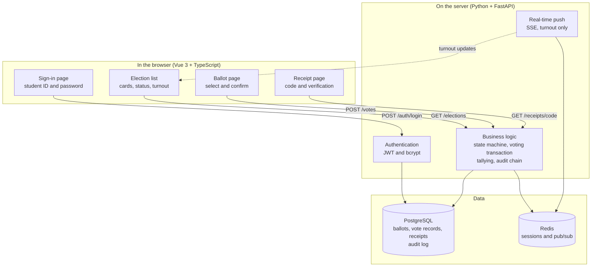
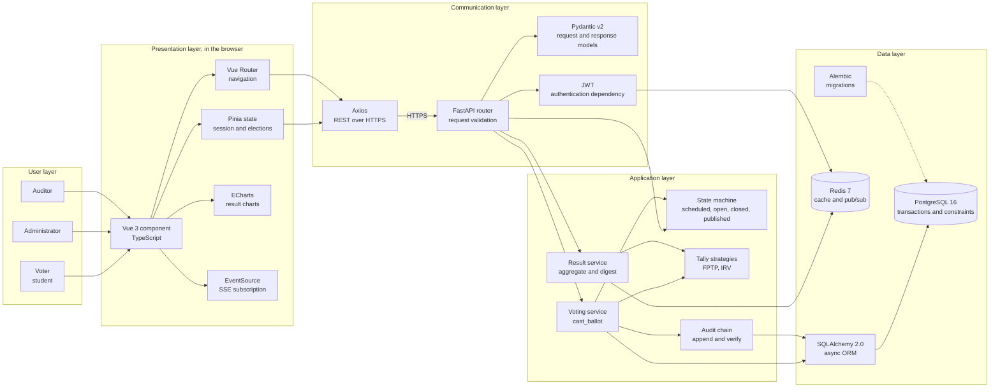
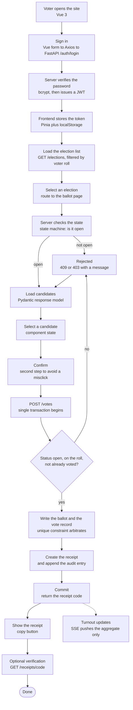
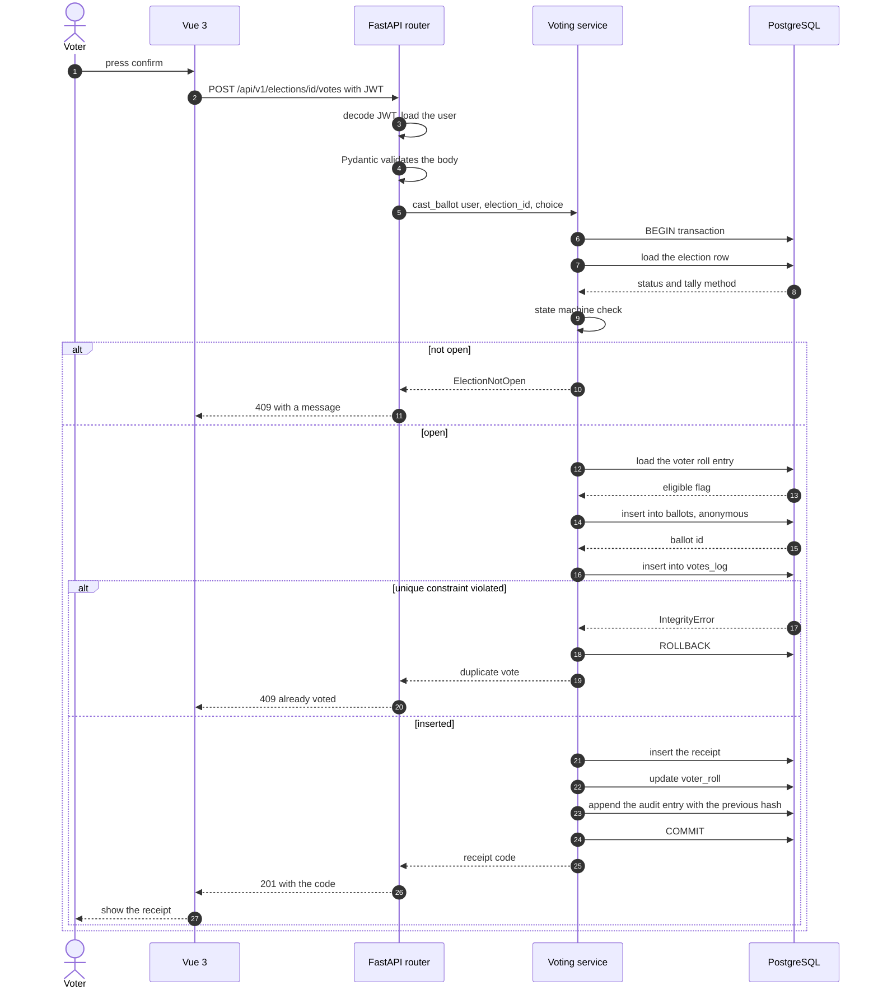
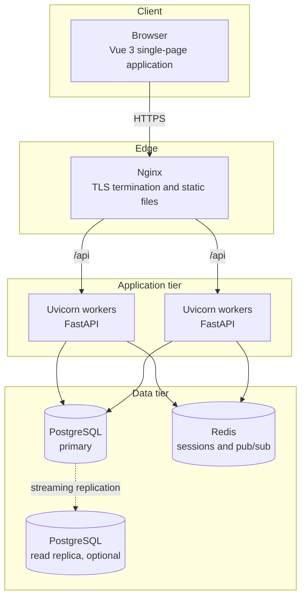

# System Flows and Technology Stack

> COMP 3500SEF / 8500SEF — Software Engineering, group project
> Topic: Election Management and Voting System

Five diagrams at increasing levels of detail. The first two are for a general audience, the last
three for developers and for the architecture chapter.

---

## 0. Overview: process and technology in one picture

Reading order: the voter acts in the browser, the request reaches the server over HTTPS, the
business logic runs inside a database transaction, and results come back over REST or SSE.

---

## 1. Technology stack by layer

Reading order: from users down to the database, every level names the concrete language and
framework, so you can answer "what is used for what".

---

## 2. Main voting flow, step by step

---

## 3. Inside the vote transaction

This is the diagram the architecture chapter uses. It shows exactly what the backing transaction
does and where the guarantees come from.

The guarantee comes from three places, in this order:

1. **The state machine** decides whether voting is allowed at all.
2. **The unique constraint** decides whether this voter has already voted; no application-level
   check is involved.
3. **The audit chain** makes after-the-fact tampering detectable.

---

## 4. Deployment topology

For a single-machine demonstration, Nginx and the extra worker are omitted and everything runs
locally; the diagram shows the target shape.

---

## 5. Quick reference for the presentation

| Question | Answer |
|---|---|
| Frontend language | TypeScript, built with Vue 3 |
| Backend language | Python 3.11, FastAPI |
| Database | PostgreSQL 16, with SQLite fallback |
| Cache | Redis 7, used for sessions and pub/sub |
| How does real-time work | SSE, server push, one-way |
| How is one vote per voter enforced | database unique constraint on position and user |
| How is anonymity preserved | ballots and voter roll are separate tables with no linking key |
| What are the tally methods | FPTP now, IRV added by strategy pattern |
| How is tampering detected | append-only audit chain with hashes |
| How many tests | 44, including concurrency and tamper cases |

---

## 6. Where each member plugs in

| Member | Owns | Points at in this document |
|---|---|---|
| 1 | Process and planning | sections 0 and 2 |
| 2 | Requirements | sections 2 and 3 |
| 3 | Modelling | sections 3 and 4 |
| 4 | Architecture | sections 1, 4 and 5 |
| 5 | Backend implementation | sections 1 and 3 |
| 6 | Frontend implementation | sections 0 and 2 |
| 7 | Testing and evolution | sections 3 and 5 |
