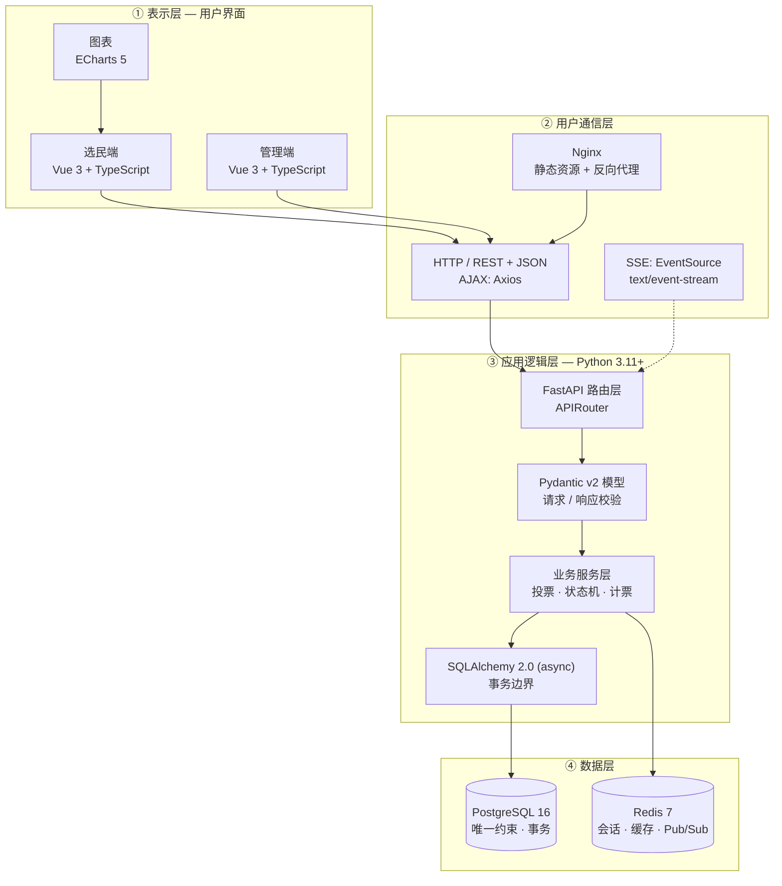
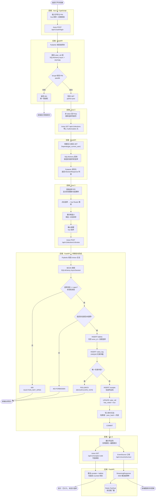
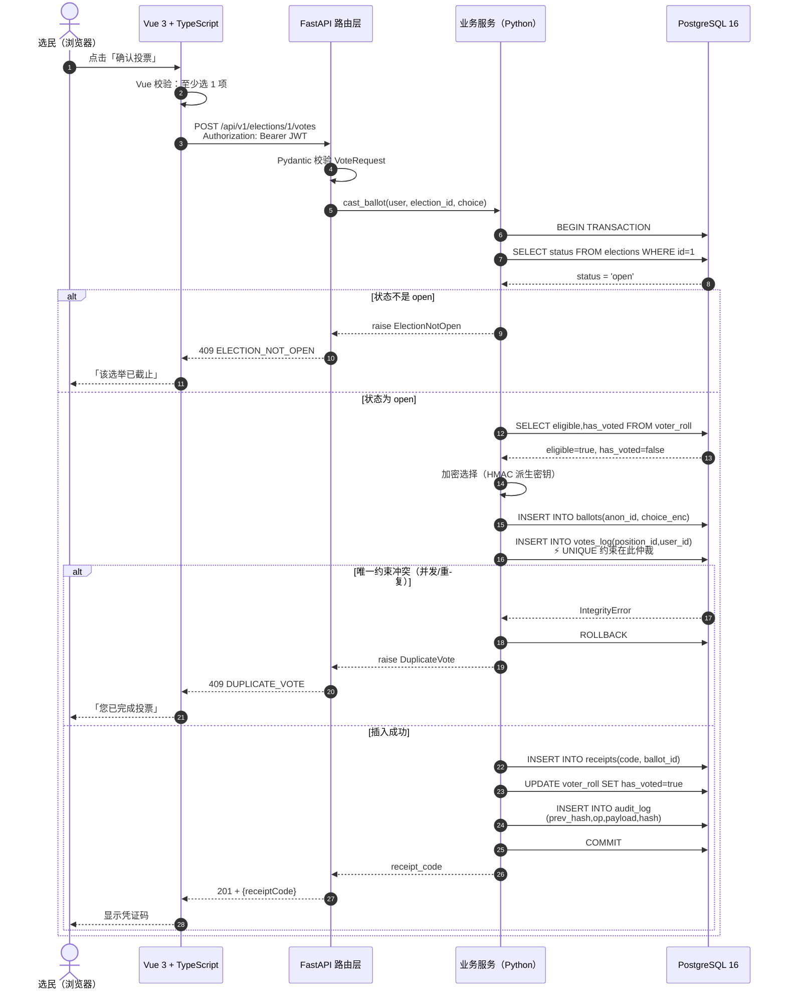
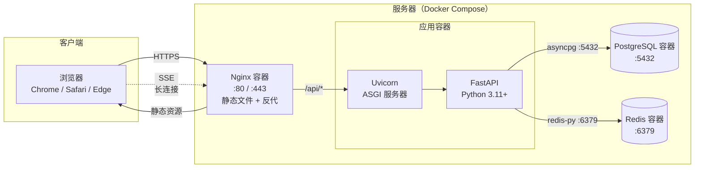

# 系统流程与技术栈详图

> COMP 3500SEF / 8500SEF — 选举管理与投票系统
> 后端已定：**Python + FastAPI**
>
> 本文的图**在每个环节标注了所用的语言 / 框架 / 组件**，可直接放进报告的「设计」章节，
> 也适合在进度评审时讲解。

---

## 一、技术栈全景（按层标注语言）

---

## 二、投票主流程（逐步标注语言与框架）

这是**一张图讲清整个系统怎么工作**：从浏览器点击到数据落库，每一步都标明用什么技术。

---

## 三、投票事务的内部时序（后端细节）

> 这一节对应报告里的「设计」与「事务一致性」，是评审最容易追问的地方。

---

## 四、部署拓扑（物理视图）

---

## 五、技术选型速查表（讲给导师用）

| 环节 | 语言 / 技术 | 为什么用它 |
|---|---|---|
| 用户界面 | **TypeScript + Vue 3** | 类型安全 + 组件化，适合表单与列表 |
| 构建工具 | **Vite 5** | 冷启动快，HMR 体验好 |
| 状态管理 | **Pinia** | 管理登录态与选举数据，比 Vuex 简洁 |
| 图表 | **ECharts 5** | 计票柱状图、逐轮淘汰可视化 |
| HTTP 调用 | **Axios** | 拦截器统一处理 401 / 错误码 |
| 实时推送 | **EventSource（SSE）** | 服务器单向推投票率，自带重连 |
| 后端框架 | **Python 3.11 + FastAPI** | 异步、自动 OpenAPI、Pydantic 契约即文档 |
| 请求校验 | **Pydantic v2** | 请求/响应模型即接口契约 |
| 数据访问 | **SQLAlchemy 2.0 async** | 显式事务边界，能精确控制 COMMIT/ROLLBACK |
| 数据库驱动 | **asyncpg** | PostgreSQL 异步驱动，性能好 |
| 数据库迁移 | **Alembic** | schema 版本化，团队协作必需 |
| 主数据库 | **PostgreSQL 16** | **唯一约束**是"一人一票"的最终保证 |
| 缓存 | **Redis 7** | 会话 + 结果缓存 + SSE 多实例 Pub/Sub |
| 鉴权 | **python-jose + passlib[bcrypt]** | JWT 签发与密码哈希 |
| 测试 | **pytest + pytest-asyncio + httpx** | 单元测试 + 异步接口测试 |
| 容器 | **Docker Compose** | 一条命令起 PostgreSQL + Redis |

---

## 六、给成员的分工落点（对应 7 人分工表）

| 成员 | 负责环节 | 用到的语言/技术 | 产出文件 |
|---|---|---|---|
| 1 | 选民端页面 | TypeScript + Vue 3 + Pinia | `frontend/src/views/Voter*` |
| 2 | 管理端页面 | TypeScript + Vue 3 + ECharts | `frontend/src/views/Admin*` |
| 3 | 认证与权限 | Python + FastAPI + python-jose | `backend/api/auth.py` |
| 4 | 选举与投票 | Python + FastAPI + SQLAlchemy | `backend/api/elections.py` |
| 5 | 数据库设计 | PostgreSQL + Alembic | `backend/db/`、`migrations/` |
| 6 | 功能与界面测试 | 手测 + Playwright（可选） | `tests/e2e/` |
| 7 | 接口与集成测试 | pytest + pytest-asyncio + httpx | `tests/api/` |
